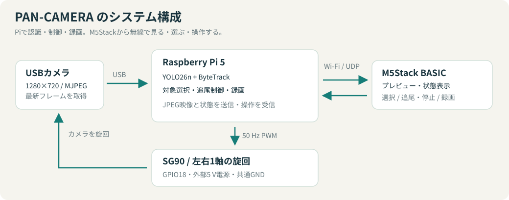

# PAN-CAMERA

**選んだ被写体に、カメラがついてくる。**

YOLOの学習済みモデルで人物や物体を認識し、サーボでUSBカメラを左右に旋回させる自動追尾カメラです。M5Stack BASICを手元のモニター兼コントローラーとして使い、被写体の選択、追尾の開始・停止、録画を操作できます。

Physical AI応用編1の最終課題として制作しました。自分を撮影するときのフレーミング補助や、動く物体を画面中央に捉えながら録画する用途を想定しています。



## できること

- YOLO26nとByteTrackによる、人物・コップなどの検出と追跡。
- 80種類の学習済みクラスから、設定ファイルまたは起動引数で検出対象を選択。
- 画面上で選んだ対象を左右方向に追尾。ずれに応じて補正量を変え、サーボ指令を加減速。
- M5Stackに認識枠付きのプレビューと追尾・録画状態を表示。B長押しでPiアプリを起動・終了。
- 追尾と独立して録画を開始・停止。認識枠付きAVI、M5Stack画面の再現AVI、枠なし映像＋マイク音声のMP4をPiへ同時保存。
- 追尾停止・対象切り替え時の位置保持と、カメラ取得エラー時の終了処理。

## 使用機材と環境

| 項目 | 構成 |
|---|---|
| 計算機 | Raspberry Pi 5 Model B / 8 GB |
| OS | Debian GNU/Linux 12（bookworm）、64 bit / aarch64 |
| カメラ | Arducam 12MP USB Camera、1280×720 MJPEGで使用 |
| 旋回機構 | SG90サーボ、GPIO18のRP1ハードウェアPWM |
| 操作端末 | M5Stack BASIC（ESP32、320×240 LCD） |
| サーボ電源 | MOT-MB10001-BKの低電流モード、PiとGND共通 |
| Pi側ソフトウェア | Python 3.11、uv、Ultralytics、PyTorch CPU、OpenCV |
| M5Stack側 | PlatformIO、Arduino ESP32、M5Unified |

図で確認する：[追尾の流れ](docs/assets/tracking-loop.svg) · [電源と配線](docs/assets/power-wiring.svg) · [固定部と回転部](docs/assets/pan-mechanism.svg)

詳しいバージョンと実測値は[検証結果](docs/validation.md)、配線とPWM準備は[ハードウェア](docs/hardware.md)にまとめています。

## セットアップ

以下はリポジトリのルートで実行します。Python 3.11以上、uv、PlatformIO CLIが必要です。枠なし映像＋音声の録画にはFFmpegとALSAの録音入力を使用します（Debian系では `sudo apt install ffmpeg alsa-utils`）。検証環境ではPi側にGUIは不要です。

```sh
uv sync --locked
cp firmware/m5stack/include/wifi_secrets.example.h firmware/m5stack/include/wifi_secrets.h
```

1. [ハードウェア手順](docs/hardware.md)に従って配線し、PWMを準備します。
2. `wifi_secrets.h` にWi-FiのSSIDとパスワードを設定します。このファイルはGit管理対象外です。
3. M5Stackを接続し、必要に応じて `platformio.ini` のUSBポートを変更します。

```sh
pio run -d firmware/m5stack -t upload
```

4. M5StackのIPアドレスを `config/network.toml` に設定します。PiとM5Stackは同じLANに接続します。

## 起動と操作

まずサーボを動かさないプレビューで接続・認識を確認します。

```sh
uv run python -m pan_camera
```

追尾を許可し、処理速度の制限を外して起動する場合：

```sh
uv run python -m pan_camera --allow-servo --fps 0
```

| ボタン | 操作 |
|---|---|
| A / SELECT | 左から順に被写体を選択。最後の対象の次はFREE。追尾中なら停止して選択を切り替え |
| B / START・STOP | 短押しで追尾を開始・停止。FREEでは中央へ復帰。長押しでPiアプリの起動・終了メニュー |
| C / REC | 録画を開始・停止 |

[起動管理サービス](docs/usage.md#m5stackからpiプログラムを起動終了)を導入すると、Pi起動後はM5StackのB長押しメニューからプログラムを起動・終了できます。

`--allow-servo` 指定時は、カメラの画像取得と制御ポートの準備に成功してから中央位置へ初期化します。初回通電時の実際の位置は取得できないため、この最初の移動速度は保証できません。

追尾を停止してもサーボは現在位置を保持します。カメラ切断時も最後のPWM指令を保持したまま録画・通信を閉じて終了し、**プロセス終了後もサーボは通電状態**です。通常終了・通信タイムアウトとは動作が異なるため、[停止・障害時の挙動](docs/usage.md#停止障害時の挙動)も確認してください。

## 検出対象のON/OFF

`config/detection.toml` に80種類を一覧化しています。現在のデフォルトはコップのみです。人物も使う場合は `person = true` に変更します。変更後はPiプログラムを再起動します。

```toml
[classes]
person = false
cup = true
bottle = false
```

`--classes` を指定した起動では、設定ファイルの代わりに指定したクラスだけを使用します。ファイル自体は変更しません。

```sh
uv run python -m pan_camera --allow-servo --fps 0 --classes person
uv run python -m pan_camera --allow-servo --fps 0 --classes cup bottle
uv run python -m pan_camera --list-classes
```

## 録画と性能

REC操作では `outputs/recordings/` に、認識枠付き640×360 AVI、M5Stack画面を再現した320×240・4 FPSのAVI、枠なし720p映像＋音声のMP4を同時に保存します。MP4は録画中にH.264＋AACへ圧縮します。解像度・画質・CPUスレッド数・マイクは `config/recording.toml` で指定します。再エンコードしない大容量MKVも設定で選択できます。録画の再生速度、負荷、容量制限は[操作ガイド](docs/usage.md#録画)を参照してください。

コップ検出・サーボ無効の計測では、カメラ約16.5 FPS、全体約13 FPS、YOLO＋追跡約70～73 msでした。3種類の録画を併用した最新構成の性能は未測定です。測定条件と限界は[検証結果](docs/validation.md)に記載しています。

```sh
uv run python -m pan_camera --profile --fps 0 --frames 300
```

## ファイル構成

```text
apps/pi/src/pan_camera/   Pi側アプリ、撮影、追跡制御、描画、録画、通信
firmware/m5stack/         M5Stackファームウェアと書き込み設定
config/                  検出対象、サーボ校正値、追跡・通信設定
deploy/                  PWM準備・M5Stack起動管理サービスのテンプレート
models/                  使用する学習済みモデルと出典情報
scripts/                 PWM準備・実機可動域確認
tests/                   実機を動かさない自動テスト
docs/                    配線、操作、設計、検証、今後の課題
outputs/                 録画などの生成物（Git管理対象外）
```

## 開発とドキュメント

```sh
uv run python -m unittest discover -s tests -v
pio run -d firmware/m5stack
```

テストは実機のカメラ・マイク・サーボを使いません。FFmpegがある環境では、生成映像・音声による録画の結合テストも実行します。ビルドや自動テストの成功と、実機での動作確認は区別しています。

- [ハードウェア・PWM準備](docs/hardware.md)
- [操作・設定・トラブル対処](docs/usage.md)
- [設計・通信仕様](docs/architecture.md)
- [検証結果・確認範囲・今後の課題](docs/validation.md)
- [提出資料のHTML（A4・2ページ）](docs/report.html)
- [動画用タイトルのSVGアニメーション](docs/video-titles.html)
- [第三者ソフトウェアとモデル](THIRD_PARTY_NOTICES.md)

本リポジトリは実機での試作プロジェクトです。上下方向の旋回、長時間運転、遮蔽後の同一対象の確実な復帰は今後の課題です。

## ライセンス

本プロジェクトで作成したコード・設定・文書・SVG図は **AGPL-3.0-only** です。[LICENSE](LICENSE) と [NOTICE](NOTICE) を参照してください。学習済みモデルと第三者のソフトウェアには各配布元の条件が適用されます。出典、利用バージョン、ライセンス本文は [THIRD_PARTY_NOTICES.md](THIRD_PARTY_NOTICES.md) にまとめています。
