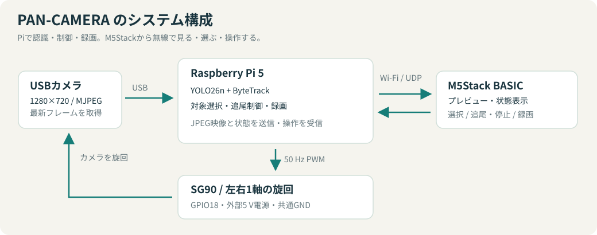
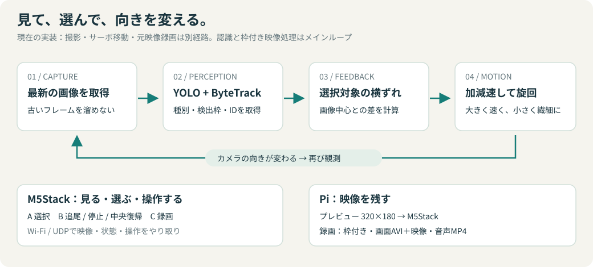

# 設計と通信

## 処理の流れ

1. カメラスレッドがUSB映像を連続取得し、最新フレームだけを保持する。元映像録画が有効な場合は、JPEGを受け取り、推論用にデコードしつつ圧縮データを録画経路へ分岐する。
2. メインループがYOLO26nをCPUで実行し、ByteTrackでIDを関連付ける。
3. 選択したIDの中心と画像中心との差から、次のPWM目標を計算する。
4. サーボスレッドが約20 msごとに距離と現在の指令速度に応じて加減速する。
5. メインループが必要なタイミングでプレビューを描画・JPEG化し、M5Stackへ送信する。
6. 録画中は認識枠付きAVIとM5Stack画面を再現したAVIを保存し、枠なし映像＋音声を別経路でMP4へ圧縮保存する（copyモードではMKV）。

撮影、サーボ移動、元JPEGの書き込みは別スレッドです。元映像の格納と音声取得にはFFmpeg子プロセスを使用します。推論、描画、JPEG送信、認識枠付きAVI・画面再現AVIの録画はメインループで動作します。映像送信は独立した送信スレッドではなく、推論とは異なる目標周期で実行します。

## モジュール

| モジュール | 責務 |
|---|---|
| `__main__.py` | `python -m pan_camera` の起動窓口 |
| `app.py` | 起動設定、対象選択、追尾状態、コマンド処理、全体の進行 |
| `camera.py` | 設定した解像度のMJPEG取得、最新フレーム保持、取得エラー伝達 |
| `detection_config.py` | 学習済みモデルのクラス名とON/OFF設定の照合 |
| `controller.py` | 画面の左右のずれからPWM目標を計算 |
| `smooth_servo.py` | 指令位置を約50 Hzで更新、加減速、保持、スレッド停止 |
| `actuator.py` | 校正値読み込み、RP1 PWM操作、排他制御、保持状態の引き継ぎ |
| `video.py` | 対象の角枠・ラベルと中心マーカー、JPEG圧縮 |
| `recorder.py` | 3種類の録画の開始・停止と終了処理をまとめる |
| `display.py` | M5Stack通常画面の再現、実時間に合わせた4 FPSのAVI保存 |
| `launcher.py` | M5StackからのPiアプリ起動・終了と状態通知 |
| `raw_recorder.py` | 録画設定、容量制限付きキュー、FFmpegによる枠なし映像とALSA音声の圧縮・格納 |
| `mjpeg_stream.py` | 元JPEGへ取得側の時刻を付けるMatroskaストリーム。最終ファイルはFFmpegが生成 |
| `protocol.py` | ネットワーク設定、JPEGの分割送信、パケット形式 |
| `paths.py` | リポジトリ内のモデル・設定・出力先の基準パス |

Pi側はリポジトリのチェックアウトを `uv sync` でインストールして利用します。設定や重みを含まないPythonパッケージ単体での配布は想定していません。

## 追尾制御

選択対象の検出枠の横方向中心を使用します。現在のアプリ設定では、1280 px幅の画像に対して中央±5 pxを停止帯とし、帯の外側は小さなずれにも最低1 µsの補正を出します。大きく外れているほど補正の係数を増やし、1回の補正を最大140 µsに制限します。

サーボスレッドは目標との差から速度を決め、速度と加速度の上限を適用します。現在の設定は900 µs/秒、2700 µs/秒²です。これらはパルス幅の指令変化であり、実測した角速度・角加速度ではありません。保持指令は移動の継続より優先します。

サーボの位置センサーは読み取っていません。ログのPWMは実際の角度ではなく指令値です。補正を検出ごとに計算するため、実際のループFPSによって追尾応答も変わります。

## UDPパケット

Piは制御ポート5006にbindし、映像・状態・ACKをM5Stackの5005へ送ります。M5Stackは映像の送信元IPとポートを覚えてコマンドとハートビートを返します。ポート設定を変更する場合は両側の整合を確認してください。セッションIDとシーケンス番号は通信の世代管理・重複排除用で、暗号化や認証ではありません。同じ管理下のLANで使用します。

| 種類 | 形式・用途 |
|---|---|
| 映像 | `P2V1`、ネットワークバイト順 `!4sIIHHI`、20バイトヘッダー＋最大1024バイトのJPEG断片 |
| 状態 | `P2T2`、`!4sIIHhHBBBBHBI`、29バイト |
| 操作 | ASCII `P2C1,server_session,client_session,sequence,command` |
| 応答 | ASCII `P2A1,server_session,client_session,sequence,code` |
| 生存通知 | ASCII `P2H1,server_session,client_session` |

映像ヘッダーは識別子・サーバーセッション・フレーム番号・分割番号・分割数・JPEG総バイト数を持ちます。状態はPWM、横ずれ、処理FPS、追尾状態、対象クラス、信頼度、検出数、選択ID、録画状態と秒数を持ちます。未選択IDは65535、未選択クラスは255です。

操作は `SEL`、`TOGGLE`、`REC`。M5Stackは300 ms間隔で同じシーケンスを最大6回送信し、Piは直近128操作の応答を記憶して重複実行を防ぎます。UDP映像は再送せず、M5Stack側で断片を再構成します。

## 自動テスト

テスト対象は追尾補正、指令プロファイル、PWMの範囲・排他・保持、カメラ取得・終了、パケット分割、検出クラス、アプリの状態遷移と起動管理、録画の開始・終了・エラー、保存動画の形式と時刻です。一時ファイル・モック・生成映像と音声を使い、実機のカメラ・マイク・サーボは使いません。機械の動き、保持力、カメラ内部遅延の検証は実機で別途行います。

## 枠なし映像と音声の録画経路

`V4L2 → 元JPEG → 取得側の時刻付きMatroska入力 → FFmpeg → 保存ファイル` の経路を、認識枠付きAVIとは別に使用します。

- 既定のh264モード：libx264（ultrafast、zerolatency、CRF 26、2スレッド）＋AACでMP4へ圧縮保存。
- copyモード：MJPEGを再エンコードせず、PCM音声とMKVへ格納。

JPEGへ時刻を付ける内部ストリームは[Matroskaの要素仕様](https://www.matroska.org/technical/elements.html)に従い、キューの処理時刻ではなく投入時刻を維持します。最終ファイルの音声格納・インデックス・終了処理はFFmpegが担当します。AACの入力には時刻の小さなずれを調整する `aresample=async=1` を使用します。

生成データの結合テストで、両モードのフレーム間隔、MP4のH.264＋AACとデコード、copyモードのJPEGバイト列の一致を確認しています。カメラ・マイクの内部遅延まで補償する仕組みではありません。

## プログラムの起動管理

`pan_camera.launcher` はsystemdで常駐し、UDP 5007でM5Stackの起動・終了要求を受けます。追尾プロセスは要求があるときだけ子プロセスとして起動し、終了要求ではSIGINTを送って既存の録画・PWM終了処理を実行します。異常終了後の自動再起動は行いません。

| 種類 | ASCII形式 |
|---|---|
| 起動・終了要求 | `P2L1,manager_session,client_session,sequence,START`（または`STOP`） |
| 応答 | `P2R1,manager_session,client_session,sequence,code` |
| 1秒ごとの状態通知 | `P2S1,manager_session,pid,state` |

状態は0停止、1起動中または実行中、2終了処理中、3異常終了です。実行中判定はプロセスの生存確認で、カメラ準備完了の保証ではありません。要求のACKは受け付け結果で、完了は後続の状態通知と映像で判断します。応答コードは0成功、2終了処理中、3エラー、4古いセッションです。

要求は設定したM5StackのIPと送信元5005のみ受け付け、セッションと直近128要求の重複を確認します。実行できる命令は固定のSTART/STOPのみです。状態通知でPiのIPをM5Stackへ伝えるため、映像アプリが停止していても起動できます。ネットワーク上の認証や暗号化は行いません。

## M5Stack画面の再現録画

`display.py` は送信JPEGを復号した320×180の映像とPi側の状態から、通常画面の320×240画像を組み立てます。REC時に4 FPSのMJPEG AVIへ保存し、時間枠が飛んだ区間には前の画像を繰り返して実時間との対応を維持します。保持する再現画像は1枚で、追加のカメラ取得やYOLO推論は行いません。

実際のLCDや受信側状態の収集は行いません。文字は近似で、受信枚数・欠落数は未取得表示、メニュー・一時通知も対象外です。既存の認識枠付きAVIと枠なし映像＋音声の録画経路は維持しています。
