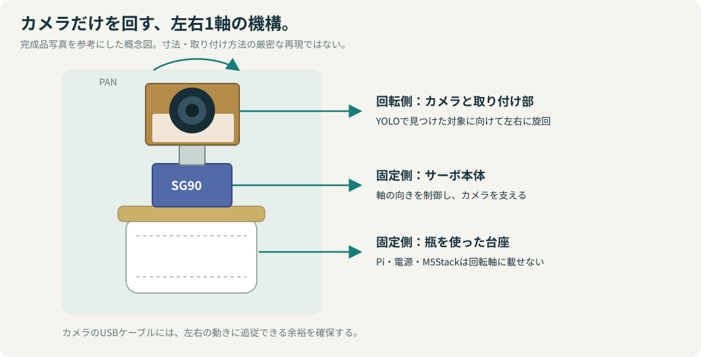
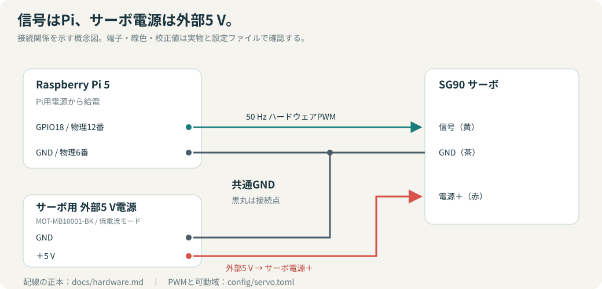

# ハードウェアと環境

## 対応するPiとOS

この実装のPWMはRaspberry Pi 5のRP1・GPIO18専用です。64 bit OS（`uname -m` が `aarch64`）、Python 3.11、RP1用PWMドライバーが必要です。Pi 4以前や32 bit OSでの動作は対象にしていません。別のPi 5で再現する場合も、カメラ・マイクの識別名、ユーザー権限、ネットワーク、サーボ校正を確認します。

## 機材

| 項目 | 使用機材 |
|---|---|
| 計算機 | Raspberry Pi 5 Model B Rev 1.0 / 8 GB |
| カメラ | Arducam 12MP USB Camera（USB ID `1bcf:28c1`） |
| 旋回機構 | SG90サーボ、左右1軸の試作マウント |
| 操作端末 | M5Stack BASIC（ESP32、320×240 LCD） |
| USBシリアル | Silicon Labs CP210x UART Bridge（USB ID `10c4:ea60`） |
| サーボ電源 | MOT-MB10001-BK、低電流モードで使用（外部5 V） |
| 配線部材 | ブレッドボード、ジャンパーワイヤー |

## ソフトウェア環境

2026-11-02の開発環境とビルドログに基づく値です。Pythonの依存関係は `uv.lock`、M5Stack側は `firmware/m5stack/platformio.ini` で管理します。

| 項目 | 確認値 |
|---|---|
| OS | Debian GNU/Linux 12（bookworm） / aarch64 |
| カーネル | 6.12.109+rpt-rpi-2712 |
| Python / uv | 3.11.2 / 0.13.6 |
| PlatformIO | Core 6.2.0 |
| Ultralytics | 8.4.197 |
| PyTorch / torchvision | 2.15.0+cpu / 0.29.2+cpu |
| OpenCV headless / lap | 4.14.0.94 / 0.5.13 |
| ESP32プラットフォーム | espressif32 6.7.0 |
| M5Unified / M5GFX | 0.2.29 / 0.2.36 |
| NumPy / FFmpeg | 2.4.6 / 5.1.9 |

## カメラの対応モード

`v4l2-ctl -d /dev/video0 --list-formats-ext` の出力で確認した、デバイスの対応モードです。記載したFPSはアプリの実測性能ではありません。

| 解像度 | MJPEG | YUYV |
|---|---:|---:|
| 416×312 | 30 FPS | 20 FPS |
| 640×480 | 30 FPS | 30 FPS |
| 800×600 | 30 FPS | 20 FPS |
| 1280×720 | 30 FPS | 10 FPS |
| 1920×1080 | 30 FPS | 5 FPS |
| 3840×2160 | 30 FPS | 1 FPS |
| 3840×2880 | 30 FPS | 1 FPS |
| 3840×3032 | 30 FPS | 1 FPS |

アプリの既定は **1280×720、MJPEG、30 FPS要求**です。`config/recording.toml` で1920×1080も選択でき、撮影・元映像録画の解像度を揃えます。取得フレームの解像度を確認します。提供されたアプリ計測ではカメラ取得は約16.5 FPSでした。原因はまだ切り分けていません。30 FPSが列挙されていても、実際の露光・USB接続・ドライバー・画像処理などを含む取得速度が一致するとは限りません。

## カメラ内蔵マイク

`arecord -l` で、カード名 `Camera`（Arducam 12MP USB Camera）、デバイス0の `USB Audio` を確認しています。録音入力は `plughw:CARD=Camera,DEV=0` として設定します。別のマイクでは `config/recording.toml` の `audio_device` を `arecord -l` の結果に合わせます。マイクがない場合は `raw_enabled = false` で枠なし映像＋音声を無効にできます。デバイスの列挙確認と、実際の録音・同期の確認は別です。

## カメラとサーボの取り付け



完成品の写真では、瓶を台座にし、その上にSG90とカメラを載せた構成を確認しています。図はこの外観をもとにした概念図で、寸法図ではありません。

- Arducamをサーボホーン側に固定し、1500 µsでカメラが正面を向くよう調整する。
- USBケーブルが可動域の両端で引っ張られないよう余裕を持たせる。
- 配線や取り付けを変更するときは電源を切る。

## サーボ配線



| SG90 | 接続先 |
|---|---|
| 黄色：信号 | Pi GPIO18 / 物理12番 |
| 赤色：電源 | 外部5 V電源のプラス |
| 茶色：GND | 外部電源GNDとPi GND（開発機では物理6番） |

サーボはPiの5 Vピンから給電せず、外部電源とPiのGNDを共通化します。未使用の電源ケーブル芯線は個別に絶縁します。

## PWMと校正

| 項目 | 設定 |
|---|---|
| PWM方式 | Raspberry Pi 5 RP1ハードウェアPWM |
| コントローラー | `1f00098000.pwm` |
| GPIOの機能 | GPIO18 / PWM0_CHAN2 |
| チャンネル | `pwm2` |
| 周波数・周期 | 50 Hz / 20,000,000 ns |
| 右端・正面・左端 | 800 / 1500 / 2200 µs |

この可動域では実機の往復動作を確認しています。別のサーボや取り付けでは再校正してください。角度や機械的限界、長時間運転まで保証する値ではありません。

校正値と移動設定は `config/servo.toml` を正とします。追尾は約20 msごとの別スレッドで加減速し、現在は900 µs/秒、2700 µs/秒²を上限としています。可動域確認スクリプトは10 µs刻み・20 ms間隔の段階移動です。これらはPWM指令の変化量であり、実測した角速度ではありません。制御の詳細は[設計](architecture.md#追尾制御)を参照してください。

## PWMの準備

`/boot/firmware/config.txt` に次を設定して再起動します。

```ini
[all]
dtoverlay=pwm
```

実行ユーザーにPWM・カメラ・マイク・USBシリアルの権限を付けます。新しくグループを追加したら、再ログインまたは再起動して反映します。

```sh
sudo groupadd -f gpio
sudo usermod -aG gpio,video,audio,dialout "$(id -un)"
```

リポジトリルートで、グループとPWMの準備を確認します。

```sh
groups
sudo sh scripts/setup_hardware_pwm.sh
```

実行ユーザーは `gpio` グループに所属する必要があります。準備スクリプトは `/sys/class/pwm/pwmchip*/` の実体からRP1を特定し、周期とアクセス権を設定します。使用中のPWMは変更せず、準備だけでサーボを動かすこともありません。`pwmchip` の番号は環境によって異なります。

### 起動時の自動準備

開発機では `pan-camera-pwm.service` を使用しています。手動での準備が成功した後、以下をリポジトリルートで実行すると、サービスのテンプレートに現在の設置パスを設定できます。パスに空白・`|`・`&`を含まない場所で使用してください。

```sh
sed "s|@PROJECT_ROOT@|$PWD|g" deploy/pan-camera-pwm.service | sudo tee /etc/systemd/system/pan-camera-pwm.service
sudo systemctl daemon-reload
sudo systemctl enable pan-camera-pwm.service
sudo systemctl start pan-camera-pwm.service
systemctl status pan-camera-pwm.service
```

このサービスはPWMの準備専用で、追尾アプリは自動起動しません。M5StackからPiアプリも起動・終了したい場合は、[起動管理サービス](usage.md#起動管理サービスの導入)を追加します。機構や電源を変更した場合は再確認します。

## 実機での可動域確認

```sh
uv run python scripts/servo_limit_test.py
```

正面→右端→正面→左端→正面の順に動き、終了時にPWMを停止します。停止・障害時の保持の扱いは[操作ガイド](usage.md#停止障害時の挙動)、実測値と未確認事項は[検証結果](validation.md)にまとめています。
